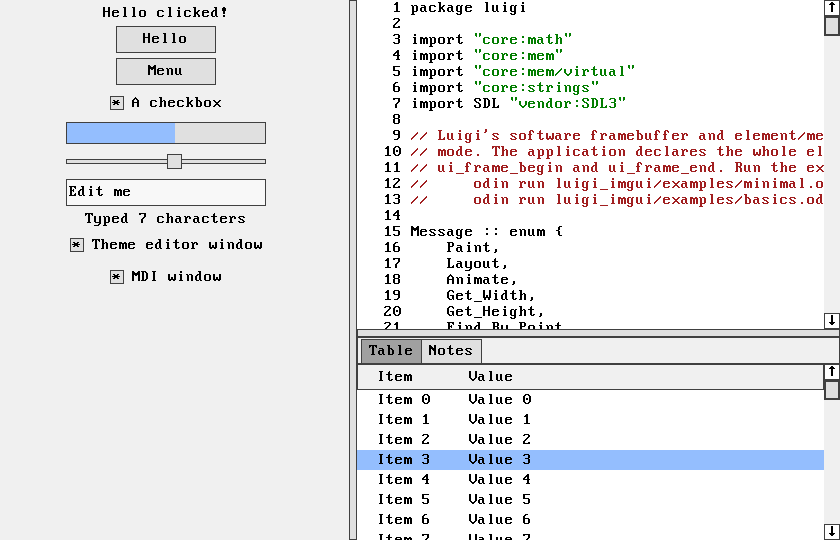
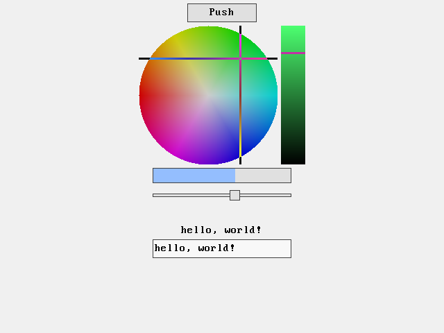
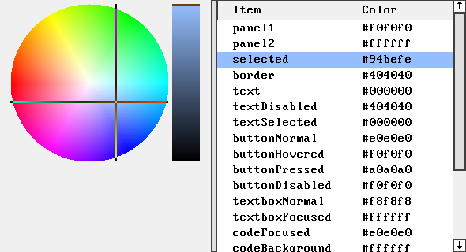
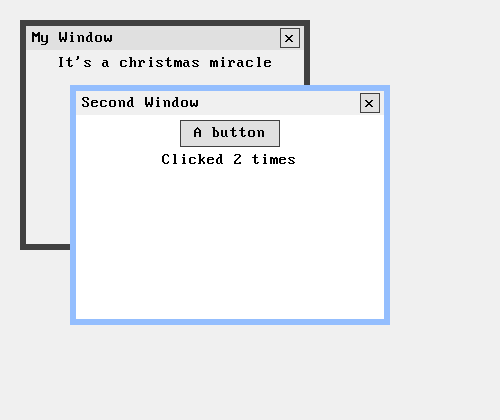
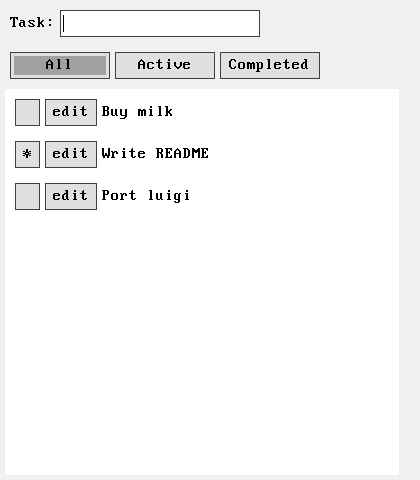

# Odin Luigi

[Luigi](https://github.com/nakst/luigi) by nakst is a barebones single-header GUI library in C: a retained element tree, message dispatch, panel layout, and a software renderer, with handwritten Win32, X11, and Essence hosts. This repository provides an Odin port of it, plus an immediate mode variant like the one the maintainer uses, heavily customized, in their own projects:

- [luigi_rmgui/luigi.odin](luigi_rmgui/luigi.odin) is an almost one to one port of `luigi.h` in retained mode. SDL3 replaces the platform hosts.
- [luigi_imgui/luigi.odin](luigi_imgui/luigi.odin) keeps the same elements, messages, painter, and layout, and only changes the core so the application declares its UI every frame. It shows that Luigi's way of building UI out of elements does not depend on retained mode.



## AI authorship

This is an AI-authored project. Its maintainer directed the work but did not write the implementation code by hand; both ports took about an hour.

## Layout

```text
luigi_rmgui/luigi.odin            retained mode library
luigi_rmgui/examples/minimal.odin the README walkthrough
luigi_rmgui/examples/basics.odin  Luigi's example program
luigi_rmgui/examples/todo.odin    Luigi's to-do list example
luigi_imgui/luigi.odin            immediate mode library
luigi_imgui/examples/minimal.odin the README walkthrough, declared every frame
luigi_imgui/examples/basics.odin  Luigi's example program, declared every frame
luigi_imgui/examples/todo.odin    Luigi's to-do list example, declared every frame
assets/                           screenshots for this README
```

Each library is a single file in its own package directory, and each example is a single file that imports its library as `..`. That keeps the repository small, but it is not how you would use Odin's package system in a project. There you would copy the library in as a subpackage, for example `src/luigi/luigi.odin` with `src/main.odin` doing `import "luigi"`, and change it as you see fit.

## Running the examples

You need a current Odin compiler and SDL3 available to Odin's `vendor:SDL3` package. There is no build script. Run the examples from the repository root, each as a single file:

```sh
odin run luigi_rmgui/examples/minimal.odin -file
odin run luigi_rmgui/examples/basics.odin -file
odin run luigi_rmgui/examples/todo.odin -file
odin run luigi_imgui/examples/minimal.odin -file
odin run luigi_imgui/examples/basics.odin -file
odin run luigi_imgui/examples/todo.odin -file
```

The renderer is plain software rendering, so add `-o:speed` for an optimized build. The screenshots below come from the immediate mode examples; the retained ones look the same.

`minimal` is the walkthrough from the documentation below.



`basics` recreates Luigi's `luigi_example.c`: the main view above, a theme editor, and an MDI window. Its code view shows the library's own source.

 

`todo` recreates Luigi's `todo_list_example.cpp`: type a task and press Enter, check it off, edit it, and filter by tab. The retained version destroys and rebuilds item rows as the list changes. The immediate mode version loops over the items every frame.



## By the numbers

Code lines without blank lines and comments, counted against upstream `luigi.h` at commit `ae28b9e`:

| | Lines |
| --- | ---: |
| `luigi.h`, total | 4,865 |
| X11, Win32, and Essence hosts | 1,123 |
| FreeType, debug inspector, and SSE2 paths (not ported) | 216 |
| `luigi.h`, portable core | 3,526 |
| `luigi_rmgui/luigi.odin`, including its SDL3 host | 2,873 |
| `luigi_imgui/luigi.odin`, including its SDL3 host | 2,836 |

About three quarters of the lines in the immediate mode library are identical to the retained one and in the same order. The painter, font, panel layout, scroll bar geometry, and most message handlers are shared word for word.

The `basics` examples recreate `luigi_example.c` (171 lines) in about 200 lines each. Luigi's to-do list (116 lines of C++) takes 131 lines in retained mode and 76 in immediate mode. The Odin numbers come from `odinfmt` output, which puts every enum value and struct field on its own line.

## Notes from using Luigi-style UIs

From the maintainer, who uses UIs like Luigi in their own projects:

- Global state is meh. These ports keep Luigi's global `ui` state; your own version is better off without it, or with a UI context that is passed around.
- The procedure signatures can be optimized or simplified for your own version. They stay close to Luigi here so the two are easy to compare.
- The software renderer is nice and simple. Build in release mode (`-o:speed`) for an optimized renderer.
- There are no dependencies besides SDL3. For a real application you should probably replace SDL3 with your own platform layer.

## Documentation

### Introduction

Import the library directory as a package. The walkthrough below is `luigi_rmgui/examples/minimal.odin`, and its immediate mode version is `luigi_imgui/examples/minimal.odin`. Call `ui_initialize`, create a window with `window_create`, and fill it with the `*_create` procedures. Then call `ui_message_loop`, and input starts being processed.

Windows are built up of *elements*, which the `*_create` procedures allocate and return. Every element type embeds the common `Element` struct with `using element: Element`, so its fields are reachable directly (`button.parent`) or through `&button.element`. When you create an element, you give its parent. Each element positions its children, and every element is clipped to its parent.

Elements respond to events and requests through messages. The `Message` enum lists every message that `element_message` can send. A message comes with an integer `data` and a pointer `payload`, and the receiving element returns an integer; when the meaning is not specified or the message is not handled, it returns 0. `element_message` first calls the element's `message_user` handler. If that returns 0, the message also goes to `message_class`. The `*_create` procedures set `message_class`; you may set `message_user` to receive messages too.

For example, the `message_class` that `button_create` sets draws the button on `.Paint`. You will usually set `message_user` to receive `.Clicked`.

### Basic example

An empty window:

```odin
package main

import luigi "luigi_rmgui"

main :: proc() {
	luigi.ui_initialize()
	defer luigi.ui_shutdown()
	window := luigi.window_create("My First Application", 640, 480)
	luigi.ui_message_loop()
}
```

To lay out other elements, add a panel. By default a panel places its children from top to bottom; add `.Horizontal` for left to right. Its `gap` sets the spacing between children and `border` the space around them.

```odin
panel := luigi.panel_create(&window.element, {.Gray, .Medium_Spacing})
```

Now add some elements to the panel. Laying out the window once at the end positions everything:

```odin
// Package-level variables:
color_picker: ^luigi.Color_Picker
gauge: ^luigi.Gauge
slider: ^luigi.Slider
label: ^luigi.Label
textbox: ^luigi.Textbox

...

panel := luigi.panel_create(&window.element, {.Gray, .Medium_Spacing})
button := luigi.button_create(&panel.element, "Push")
color_picker = luigi.color_picker_create(&panel.element)
gauge = luigi.gauge_create(&panel.element)
slider = luigi.slider_create(&panel.element)
luigi.spacer_create(&panel.element, 0, 20)
label = luigi.label_create(&panel.element, "Label")
textbox = luigi.textbox_create(&panel.element)
luigi.element_refresh(&window.element)
```

To add interactivity, set message handlers for the button, slider, and textbox:

```odin
button.message_user = button_message
slider.message_user = slider_message
textbox.message_user = textbox_message
```

When the button is clicked, set the color picker to white:

```odin
button_message :: proc(element: ^luigi.Element, message: luigi.Message, data: int, payload: rawptr) -> int {
	if message == .Clicked {
		color_picker.saturation = 0
		color_picker.value = 1
		luigi.element_refresh(&color_picker.element) // Lay out and repaint the color picker.
	}
	return 0
}
```

Make the gauge follow the slider:

```odin
slider_message :: proc(element: ^luigi.Element, message: luigi.Message, data: int, payload: rawptr) -> int {
	if message == .Value_Changed {
		gauge.position = slider.position
		luigi.element_refresh(&gauge.element)
	}
	return 0
}
```

And make the label show the textbox's contents:

```odin
textbox_message :: proc(element: ^luigi.Element, message: luigi.Message, data: int, payload: rawptr) -> int {
	if message == .Value_Changed {
		luigi.label_set_content(label, string(textbox.text[:]))
		// The label's width may have changed, so lay out its panel again.
		luigi.element_refresh(label.parent)
	}
	return 0
}
```

### The same example in immediate mode

With the immediate mode library, the application declares its elements every frame and keeps its own values. There are no element variables, no handlers, and no refresh calls:

```odin
package main

import luigi "luigi_imgui"

main :: proc() {
	luigi.ui_initialize()
	defer luigi.ui_shutdown()

	color := luigi.Color_HSV{value = 1, opacity = 1}
	position: f32
	text: [dynamic]u8
	defer delete(text)

	for luigi.ui_frame_begin() {
		window := luigi.window_create("My First Application", 640, 480)
		panel := luigi.panel_create(&window.element, {.Gray, .Medium_Spacing})
		if luigi.button(&panel.element, "Push") {
			color.saturation = 0
			color.value = 1
		}
		luigi.color_picker_create(&panel.element, &color)
		luigi.gauge_create(&panel.element, position)
		luigi.slider(&panel.element, &position)
		luigi.spacer_create(&panel.element, 0, 20)
		luigi.label_create(&panel.element, string(text[:]) if len(text) > 0 else "Label")
		luigi.textbox(&panel.element, &text)
		luigi.ui_frame_end()
	}
}
```

`ui_frame_begin` waits for input, routes it through the previous frame's elements with the same messages as the retained library, and starts a new frame. Handlers no longer change application data. They record events by element ID, which the next frame reads: `button` returns true once after a click, and `checkbox`, `slider`, `textbox`, and `color_picker_create` write the new value through the pointer you pass. `ui_frame_end` lays out and paints every window, and closes windows that were not declared this frame.

Elements live only until the next frame begins. Their IDs hash the label with the parent's ID, so a label like `"OK##save"` displays `OK` but stays distinct from another `OK` button. Unlabeled elements are numbered in declaration order under their parent. State that must outlast a frame, such as scroll positions, split weights, the active tab, textbox editing, and MDI frames, is kept per ID and freed when its element stops being declared. Hover, press, and focus are IDs as well.

### Rect

`Rect` holds four integers, `l`, `r`, `t`, and `b`: the left, right, top, and bottom edges. Coordinates are usually pixels relative to the top-left corner of the window. `rect(l, r, t, b)` builds one; `rect_width`, `rect_height`, `rect_contains`, `rect_intersection`, `rect_bounding`, `rect_add`, `rect_translate`, and `rect_inset` work with them.

### Element

The common struct embedded in every element:

```odin
Element :: struct {
	flags:                       Element_Flags,
	id:                          u32,
	parent, next, children:      ^Element,
	window:                      ^Window,
	bounds, clip:                Rect,
	user_data:                   rawptr,
	message_class, message_user: Message_Handler,
	class_name:                  string,
}
Message_Handler :: proc(element: ^Element, message: Message, data: int, payload: rawptr) -> int
```

`flags` holds the flags common to all elements; options specific to one element type live in that type, such as `Panel_Flags` or `Button_Flags`.

- `.V_Fill` asks the parent to give the element all available vertical space.
- `.H_Fill` asks the parent to give the element all available horizontal space.
- `.Disabled` disables the element. It receives no input messages.
- `.Hide` hides the element. It receives no input, is not drawn, and takes no space in its parent's layout.
- `.Tab_Stop` makes the element a tab stop that the Tab key can focus.
- `.Parent_Push` pushes the element on the parent stack; see `element_parent_push`.
- `.Non_Client` marks an element as part of its parent rather than its content, such as a table's scroll bar. `element_destroy_descendents` keeps it, the parent is not asked for a `.Client_Parent` during its creation, and panels leave it out of their layout.
- `.Destroy` marks the element for destruction. Do not set it directly; call `element_destroy`.

`parent` points to the element's parent and `next` to its next sibling. `children` points to the first child; children are linked by `next`. `window` is the window containing the element.

`bounds` is the element's rectangle in window coordinates and `clip` its clip region. Do not set them directly; call `element_move`.

`user_data` is free for the application.

`message_class` and `message_user` are the element's message handlers, described in the introduction. Do not call them directly; call `element_message`.

In the immediate mode library, `id` is a hashed `Id`, the element also keeps a `last_child` link, and `.Destroy` does not exist: an element is gone when it is not declared.

### Procedures

```odin
// General.
ui_initialize :: proc() -> bool
ui_shutdown :: proc()
ui_message_loop :: proc()
animate_clock :: proc() -> u64 // In ms.

// Creating elements.
element_create      :: proc($T: typeid, parent: ^Element, flags: Element_Flags, handler: Message_Handler, name: string) -> ^T
button_create       :: proc(parent: ^Element, label: string, flags := Button_Flags{}) -> ^Button
checkbox_create     :: proc(parent: ^Element, label: string) -> ^Checkbox
code_create         :: proc(parent: ^Element, no_margin := false) -> ^Code
color_picker_create :: proc(parent: ^Element, has_opacity := false) -> ^Color_Picker
expand_pane_create  :: proc(parent: ^Element, label: string, panel_flags := Panel_Flags{}) -> ^Expand_Pane
gauge_create        :: proc(parent: ^Element) -> ^Gauge
image_display_create :: proc(parent: ^Element, bits: []u32, width, height: int, interactive := false, stride := 0) -> ^Image_Display
label_create        :: proc(parent: ^Element, text: string, flags := Element_Flags{}) -> ^Label
mdi_child_create    :: proc(client: ^MDI_Client, frame: Rect, title: string, close_button := true) -> ^MDI_Child
mdi_client_create   :: proc(parent: ^Element, transparent := false) -> ^MDI_Client
menu_create         :: proc(parent: ^Element, place_above := false) -> ^Menu
panel_create        :: proc(parent: ^Element, flags := Panel_Flags{}) -> ^Panel
scroll_bar_create   :: proc(parent: ^Element, horizontal := false) -> ^Scroll_Bar
slider_create       :: proc(parent: ^Element) -> ^Slider
spacer_create       :: proc(parent: ^Element, width, height: int, line := false) -> ^Spacer
split_pane_create   :: proc(parent: ^Element, vertical: bool, weight: f32) -> ^Split_Pane
tab_pane_create     :: proc(parent: ^Element, titles: string) -> ^Tab_Pane // Separate titles with \t.
table_create        :: proc(parent: ^Element, columns: string) -> ^Table   // Separate columns with \t.
textbox_create      :: proc(parent: ^Element) -> ^Textbox
window_create       :: proc(title: cstring, width := 800, height := 600) -> ^Window
wrap_panel_create   :: proc(parent: ^Element) -> ^Wrap_Panel

// General elements.
element_animate             :: proc(e: ^Element, stop := false) -> bool
element_destroy             :: proc(e: ^Element)
element_destroy_descendents :: proc(e: ^Element)
element_find_by_point       :: proc(e: ^Element, x, y: int) -> ^Element
element_focus               :: proc(e: ^Element)
element_screen_bounds       :: proc(e: ^Element) -> Rect // In the coordinates SDL uses for windows.
element_refresh             :: proc(e: ^Element)
element_repaint             :: proc(e: ^Element, region: ^Rect = nil)
element_move                :: proc(e: ^Element, bounds: Rect, always_layout := false)
element_message             :: proc(e: ^Element, kind: Message, data: int = 0, payload: rawptr = nil) -> int
element_parent_push         :: proc(e: ^Element)
element_parent_pop          :: proc() -> ^Element

// Specific elements.
code_focus_line      :: proc(code: ^Code, index: int)       // Line numbers start at 1.
code_hit_test        :: proc(code: ^Code, x, y: int) -> int // Line number, negative in the margin, 0 off a line.
code_insert_content  :: proc(code: ^Code, content: string, replace := false)
label_set_content    :: proc(label: ^Label, text: string)
menu_add_item        :: proc(menu: ^Menu, label: string, invoke: proc(user_data: rawptr), user_data: rawptr = nil) -> ^Button
menu_show            :: proc(menu: ^Menu)
table_hit_test       :: proc(table: ^Table, x, y: int) -> int // Item index, or -1 off an item.
table_ensure_visible :: proc(table: ^Table, index: int) -> bool // False if the item was already visible.
table_resize_columns :: proc(table: ^Table)
textbox_replace      :: proc(box: ^Textbox, insertion: string, notify := true)
textbox_clear        :: proc(box: ^Textbox, notify := true)
textbox_move_caret   :: proc(box: ^Textbox, backward, by_word: bool)
window_register_shortcut :: proc(w: ^Window, shortcut: Shortcut)
window_post_message  :: proc(w: ^Window, kind: Message, payload: rawptr = nil) -> bool // Thread-safe.
dialog_show          :: proc(owner: ^Window, message_text: string, choices: []string) -> string
dialog_show_format   :: proc(owner: ^Window, format: string, arguments: []Dialog_Argument) -> string

// Graphics.
draw_block     :: proc(painter: ^Painter, bounds: Rect, color: u32)
draw_invert    :: proc(p: ^Painter, bounds: Rect)
draw_line      :: proc(p: ^Painter, x0, y0, x1, y1: int, color: u32) -> bool
draw_glyph     :: proc(p: ^Painter, x0, y0: int, character: u8, color: u32)
draw_rectangle :: proc(painter: ^Painter, bounds: Rect, fill, border: u32, thickness := 1)
draw_border    :: proc(p: ^Painter, bounds: Rect, color: u32, size := 1)
draw_string    :: proc(p: ^Painter, bounds: Rect, value: string, color: u32, align := Text_Align.Left, selection: ^String_Selection = nil)
measure_string_width  :: proc(value: string) -> int
measure_string_height :: proc() -> int

// Helpers.
color_to_hsv :: proc(rgb: u32) -> (hue, saturation, value: f32, chromatic: bool)
color_to_rgb :: proc(hue, saturation, value: f32) -> u32
```

The immediate mode library has the same element procedures, except that value widgets take the application's value (`checkbox_create(parent, label, &checked)`, `slider_create(parent, &position)`, `textbox_create(parent, &buffer)`, `color_picker_create(parent, &color)`, `gauge_create(parent, position)`, `code_create(parent, content)`, `table_create(parent, columns, item_count)`). It drops `element_destroy`, `element_refresh`, `element_repaint`, the dialogs, and `window_post_message`, and adds:

```odin
ui_frame_begin :: proc() -> bool // Returns false once the application should quit.
ui_frame_end   :: proc()

button   :: proc(parent: ^Element, label: string, flags := Button_Flags{}) -> bool // Clicked since the last frame.
checkbox :: proc(parent: ^Element, label: string, checked: ^bool) -> bool         // Each returns whether the value changed.
slider   :: proc(parent: ^Element, position: ^f32, steps := 0) -> bool
textbox  :: proc(parent: ^Element, buffer: ^[dynamic]u8) -> bool

element_clicked           :: proc(e: ^Element) -> bool
table_clicked             :: proc(table: ^Table) -> (row: int, clicked: bool)
window_close_requested    :: proc(w: ^Window) -> bool
mdi_child_close_requested :: proc(mdi: ^MDI_Child) -> bool
window_shortcut           :: proc(w: ^Window, code: SDL.Keycode, ctrl := false, shift := false, alt := false) -> bool
menu_open                 :: proc(anchor: ^Element, place_above := false)
menu_create               :: proc(anchor: ^Element) -> ^Menu // nil while the menu is closed.
menu_item                 :: proc(menu: ^Menu, label: string) -> bool
element_state             :: proc(e: ^Element, $T: typeid, destroy: proc(data: rawptr) = nil) -> (state: ^T, created: bool)
```

### Messages

```odin
// General events.
Paint,               // payload = ^Painter
Layout,
Destroy,
Update,
Animate,
Scrolled,            // Sent to the parent of a scroll bar.

// Layout.
Get_Width,           // data = height, if known; return the width
Get_Height,          // data = width, if known; return the height
Client_Parent,       // payload = ^^Element; set it to the parent for client elements

// Mouse input.
Clicked,
Left_Down, Left_Up,
Middle_Down, Middle_Up,
Right_Down, Right_Up,
Mouse_Move,
Mouse_Drag,
Mouse_Wheel,         // data = delta; return 1 if handled

// Cursors.
Find_By_Point,       // payload = ^Find_By_Point; return 1 if handled
Get_Cursor,          // return a Cursor_Style
Pressed_Descendent,  // payload = the pressed element

// Keyboard input.
Key_Typed,           // payload = ^Key_Typed; return 1 if handled

// Element-specific.
Value_Changed,       // The element's value changed.
Table_Get_Item,      // payload = ^Table_Get_Item
Code_Get_Margin_Color, // data = line number, from 1; return a color
Code_Decorate_Line,  // payload = ^Code_Decorate_Line
Window_Close,        // return 1 to prevent the default (quit for a window, close for an MDI child)
Tab_Selected,
Window_Drop_Files,   // payload = ^Drop_Files
Window_Activate,
User,
```

The immediate mode library drops `Destroy`, `Update`, `Scrolled`, `Value_Changed`, `Window_Close`, `Tab_Selected`, `Window_Drop_Files`, and `Window_Activate`; the outcomes they reported become events read by the next frame.

## Projects made with Luigi

Luigi's [own README](https://github.com/nakst/luigi#projects-made-with-luigi) shows what it has been used for, including the [gf](https://github.com/nakst/gf) GDB frontend and the Essence designer, and lists bindings for other languages.

## Is it lightweight and blazing fast? 🚀

The original answer still applies: no, that would require a rewrite in JavaScript.

## License and upstream attribution

This repository's code is licensed under the [zlib license](LICENSE). It is a port of Luigi, © 2020 nakst, which is available under the MIT License or the Unlicense; see [third-party notices](THIRD_PARTY_NOTICES.md).
